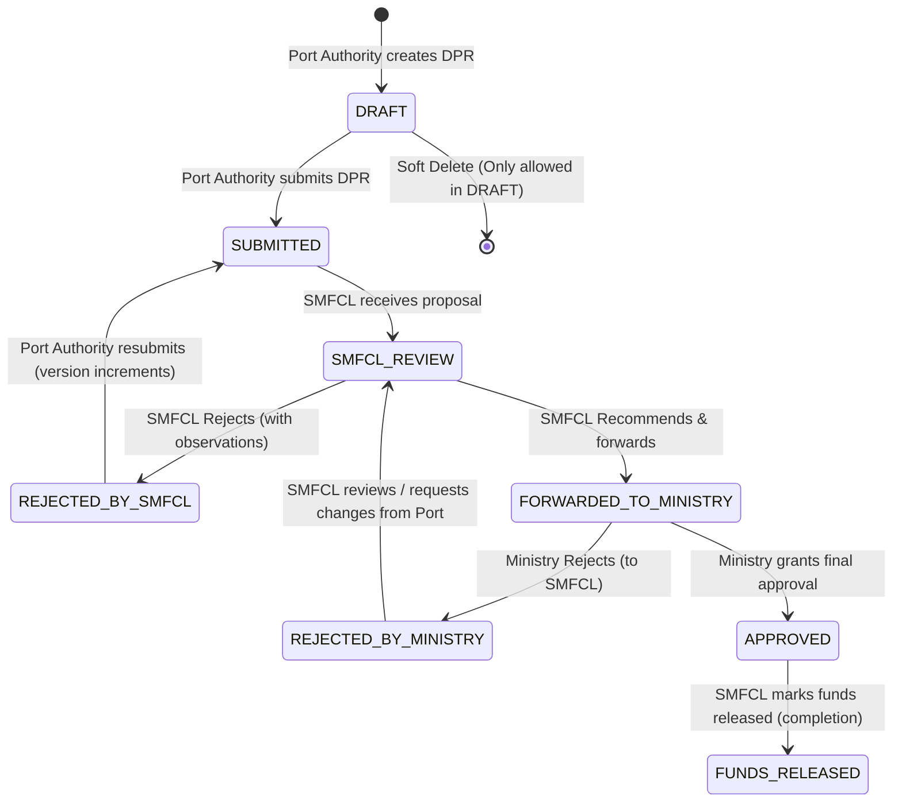

# Sagarmala 2.0 Portal — MVP Project Plan & Scaffold

The **Sagarmala 2.0 Portal** is a full-stack web application designed for the Ministry of Ports, Shipping and Waterways (MoPSW) and the Sagarmala Development Company Limited (SMFCL) to manage, appraise, and approve port-led infrastructure projects. 

This repository contains the working full-stack skeleton: **FastAPI backend** (SQLModel + PostgreSQL) + **Vite/React/TypeScript/Tailwind CSS** frontend, preloaded with the base database schema, standard API envelopes, global error handling, and scaffolded feature modules.

---

## 1. Project Context & Vision

Sagarmala 2.0 is a flagship initiative of the Government of India under the **Viksit Bharat 2047** mission, focusing on port modernization, maritime industrialization, shipbuilding, coastal community development, multimodal connectivity, and sustainable maritime practices.

The complete RFP describes a large system comprising 26+ modules, mobile apps, drone/satellite media integration, and PFMS integration.

**Our 15–20 Day MVP Focuses on Phase I (Appraisal & Sanction) Only.**
The goal of this MVP is to build a fully working, highly polished prototype of the core proposal and approval loop. It demonstrates the value proposition to the client by showing how a project proposal flows transparently across Port Authorities, SMFCL, and the Ministry, supported by a rigorous audit trail and real-time dashboard analytics.

---

## 2. Core Workflow & State Machine

The core feature of the portal is the **DPR (Detailed Project Report) Submission & Approval Workflow**. 
A DPR transitions through the following states in a strict, audited state machine:



### Transition Integrity & Auditing
1. **Audit Logs:** Every status transition writes a row to the `dpr_audit_log` capturing the **actor, action, timestamp, and review comments**.
2. **Immutability:** Once a DPR leaves the `DRAFT` state, it is read-only for the Port Authority. It cannot be deleted or modified outside of formal resubmission loops.
3. **Soft Delete:** A DPR can only be soft-deleted (`is_active = false`) while it remains a `DRAFT`.

---

## 3. Technology Stack & Architecture

The application implements a clean, decoupled **Layered Architecture** designed to scale:

```
┌────────────────────────────────────────────────────────┐
│  Presentation Layer (Frontend)                         │
│  React 19 + TypeScript + Tailwind CSS v4 + shadcn/ui   │
└────────────────────────────────────────────────────────┘
                           │
                           │ REST API (JSON / Standard Envelopes)
                           ▼
┌────────────────────────────────────────────────────────┐
│  Application / Service Layer (Backend)                 │
│  FastAPI + Pydantic + Standard Response Envelopes       │
└────────────────────────────────────────────────────────┘
                           │
                           │ SQLModel / SQLAlchemy Engine
                           ▼
┌────────────────────────────────────────────────────────┐
│  Data Layer (Persistence)                              │
│  PostgreSQL (Local / Docker) + Alembic Migrations      │
└────────────────────────────────────────────────────────┘
```

### Architectural Decisions (Locked per `DECISION_RULES.md`)
*   **D1. No Repository Layer:** The backend layering is strictly `Route → Service → SQLModel Session`. Services talk to the database directly to minimize CRUD boilerplate.
*   **D2. Soft Delete:** Business records (Projects, Tasks, Stakeholders, Meetings, DPRs) use `is_active: bool` rather than hard deletes. Audit trails are never deletable.
*   **D3. Notifications are Backend-Only:** Scaffolding contains the `Notification` model, a service helper `create_notification()`, and `GET /notifications`. No frontend inbox/bell is built for the MVP.
*   **D5. Permission-Based RBAC:** Routes are protected via `require_permission("PERMISSION_NAME")` evaluated dynamically against user roles, rather than hardcoded role string checks.
*   **D7. API Contract Envelopes:** List responses return pagination metadata. Error responses return standard code-based structures:
    *   **List Success:** `{ "data": [...], "meta": { "page": 1, "page_size": 20, "total": X } }`
    *   **Detail Success:** `{ "data": {...}, "meta": {} }`
    *   **Error:** `{ "error": { "code": "ERROR_CODE", "message": "Reason details", "field": null } }`
*   **D11. Secure Read Schemas:** API routes always return custom `*Read` schemas (e.g. `UserRead`, `ProjectRead`) rather than raw database models. This ensures sensitive properties like `password_hash` physically cannot leak to the frontend.

---

## 4. MVP Modules & Team Responsibilities

Work is divided into 6 vertical slices. Each developer owns their module's frontend directories, API routes, database tables, and logic:

| Module | Owner | Core Scope & Workflow |
| :--- | :--- | :--- |
| **1. Admin & Access Control (RBAC)** | **Senior (Lead)** | User sign-in, JWT token issuance, dynamic permission validation, and user/role administration. |
| **2. Project Configuration** | Junior 1 | Setting up the project spine (`Project` model), categories, geographic mapping (states/ports), estimated costs, and lifecycle stage tracking. |
| **3. DPR Submission & Approval** | Junior 2 | DPR lifecycle state machine, resubmission loops, version increments, and logging to the `dpr_audit_log` trail. |
| **4. Task Management** | Junior 3 | Creating, assigning, scheduling, and updating tasks (`Task` model) linked to projects. |
| **5. Stakeholder & Meeting** | Junior 4 (Integration Owner) | Directory of external stakeholders and meeting minutes logger. Also owns the shared component library and demo `seed.py` script. |
| **6. Dashboard / MIS** | **Senior (Lead)** | Real-time analytical view with KPI cards, one project-by-stage bar chart, and one task-status pie chart (mocked on Day 5, wired to live data incrementally). |

---

## 5. Git Workflow & Merge Safety Rules

To keep the development pipeline stable, the team adheres to these rules:

1.  **Branching Structure:** Branch from `develop` into `feature/<module-name>`. Never commit to `main` or `develop` directly. Raise PRs targeting the `develop` branch.
2.  **Start-of-Day Rebase:** Pull/rebase the latest `develop` into your feature branch at the start of every work cycle to resolve conflicts early.
3.  **Alembic Migration Safety (Rule D8):** 
    *   **Juniors do not run `alembic revision`.** 
    *   Juniors write/modify their SQLModel tables in `backend/app/models/` and commit them.
    *   The **Senior Lead** is the only person who runs `alembic revision --autogenerate` and applies the migration when merging feature branches into `develop`. This prevents database migration forks and broken revision chains.

---

## 6. Quickstart & Installation

Ensure you have Python 3.10+ and Node.js 18+ installed.

### Step 1: Database Setup
Make sure PostgreSQL is running on your machine.
1. Create a database named `sagarmala`.
2. Create a user named `sagarmala` with password `sagarmala` (or match your local configurations).

### Step 2: Backend Setup
```bash
cd backend

# Create and activate virtual environment
python3 -m venv venv
source venv/bin/activate  # On Windows use: venv\Scripts\activate

# Install dependencies
pip install -r requirements.txt

# Configure environment variables
cp .env.example .env  # Update DATABASE_URL inside .env if needed

# Run migrations to create database schema
alembic upgrade head

# Run development server
uvicorn app.main:app --reload
```
*   **Swagger API Docs:** Available at http://localhost:8000/docs
*   **Health Check:** http://localhost:8000/health returns `{"status":"ok"}`

### Step 3: Frontend Setup
```bash
cd frontend

# Install dependencies
npm install

# Configure environment variables
cp .env.example .env

# Start dev server
npm run dev
```
*   **Vite Dev App:** http://localhost:5173

---

## 7. Codebase Folder Layout

The project structure is organized by layer on the backend and by feature on the frontend:

```
SagarMala/
├── backend/
│   ├── app/
│   │   ├── api/          # Route controllers (thin wrapper)
│   │   ├── core/         # Settings configuration
│   │   ├── db/           # SQLModel connection session
│   │   ├── models/       # SQLModel database tables
│   │   ├── schemas/      # Pydantic validation and *Read schemas
│   │   ├── services/     # Business logic & Database queries
│   │   └── main.py       # FastAPI application entrypoint
│   ├── alembic/          # Database migration version files
│   ├── requirements.txt
│   └── .env.example
│
└── frontend/
    ├── src/
    │   ├── api/          # Axios HTTP client stubs
    │   ├── components/ui/# Reusable shadcn/ui elements
    │   ├── features/     # Feature-grouped screens and assets
    │   ├── layouts/      # Dashboard and global shell layout
    │   ├── pages/        # Route-level pages
    │   ├── routes/       # Central react-router routing table
    │   ├── types/        # TypeScript types (mirrors backend *Read schemas)
    │   └── utils/        # Frontend formatting/helpers
    ├── package.json
    └── .env.example
```
