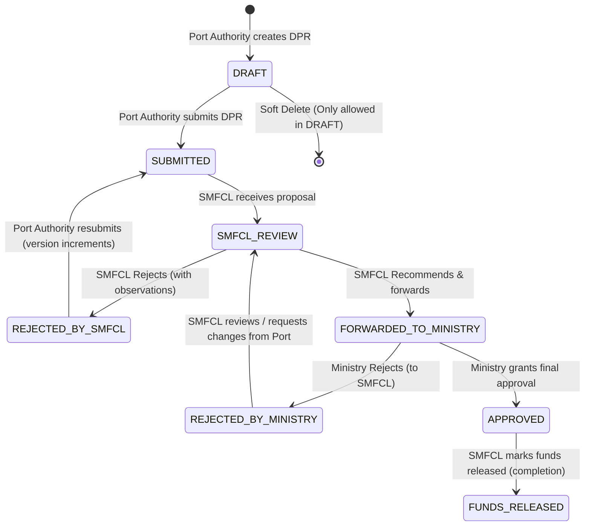

# Sagarmala 2.0 Portal (MVP Project Plan and Scaffold)

The **Sagarmala 2.0 Portal** is a full stack web application designed for the Ministry of Ports, Shipping and Waterways (MoPSW) and the Sagarmala Development Company Limited (SMFCL) to manage, appraise, and approve port led infrastructure projects.

This repository contains the working full stack application: **FastAPI backend** (SQLModel + PostgreSQL) + **Vite / React / TypeScript / Tailwind CSS** frontend, preloaded with the base database schema, standard API envelopes, global error handling, authentication, and feature modules.

**Current status:** Phase 1 (Appraisal & Sanction) is **complete and live-verified end-to-end**, tagged `phase1-mvp-complete` on `main`. Phase 2 (Pre-Construction) is **in progress** on `develop`.

---

## 1. Project Context and Vision

Sagarmala 2.0 is a flagship initiative of the Government of India under the **Viksit Bharat 2047** mission, focusing on port modernization, maritime industrialization, shipbuilding, coastal community development, multimodal connectivity, and sustainable maritime practices.

The complete RFP describes a large system comprising 26+ modules, mobile apps, drone/satellite media integration, and PFMS integration.

**Phase 1 (15–20 days) focused on Appraisal and Sanction only** — the core proposal and approval loop, showing how a project proposal flows transparently across Port Authorities, SMFCL, and the Ministry, supported by a rigorous audit trail and real-time dashboard analytics.

**Phase 2 (Pre-Construction)**, now underway, builds what happens after a DPR is approved and before construction begins: land and statutory clearances, the tender process, and contractor onboarding/contracting. Full detail in `Sagarmala_Phase2_PreConstruction_Module_Assignment.docx` and the Phase 2 team handbooks in `docs/team/`.

---

## 2. Core Workflow and State Machine (Phase 1)

The core feature of the portal is the **DPR (Detailed Project Report) Submission and Approval Workflow**.
A DPR transitions through the following states in a strict, audited state machine:



### Transition Integrity and Auditing
1. **Audit Logs:** Every status transition writes a row to `dpr_audit_log` capturing the **actor, action, old status, new status, timestamp, and review comments**.
2. **Immutability:** Once a DPR leaves the `DRAFT` state, it is read only for the Port Authority. It cannot be deleted or modified outside of formal resubmission loops.
3. **Soft Delete:** A DPR can only be soft deleted (`is_active = false`) while it remains a `DRAFT`.
4. **Notifications:** Fired (backend-only, no UI per D3) on rejection, approval, and funds-released transitions.

---

## 3. Technology Stack and Architecture

The application implements a clean, decoupled **Layered Architecture** designed to scale:

```
┌────────────────────────────────────────────────────────┐
│  Presentation Layer (Frontend)                         │
│  React 19 + TypeScript + Tailwind CSS v4 + shadcn/ui   │
└────────────────────────────────────────────────────────┘
                           │
                           │ REST API (JSON / Standard Envelopes)
                           ▼
┌────────────────────────────────────────────────────────┐
│  Application / Service Layer (Backend)                 │
│  FastAPI + Pydantic + Standard Response Envelopes       │
└────────────────────────────────────────────────────────┘
                           │
                           │ SQLModel / SQLAlchemy Engine
                           ▼
┌────────────────────────────────────────────────────────┐
│  Data Layer (Persistence)                              │
│  PostgreSQL (Local / Docker) + Alembic Migrations      │
└────────────────────────────────────────────────────────┘
```

### Architectural Decisions (Locked per `DECISION_RULES.md`)
* **D1. No Repository Layer:** `Route → Service → SQLModel Session`. Services talk to the database directly.
* **D2. Soft Delete:** Business records use `is_active: bool`. Audit trails are never deletable.
* **D3. Notifications are Backend Only:** `Notification` model + `create_notification()` + `GET /notifications`. No frontend inbox/bell.
* **D5. Permission Based RBAC:** Routes protected via `require_permission("PERMISSION_NAME")`, evaluated dynamically — never hardcoded role checks.
* **D7. API Contract Envelopes:** Standard `data`/`meta`/`error` shapes across every module.
* **D8. Single Migration Owner:** Only the Team Lead runs Alembic migrations. In Phase 2, one batched migration is generated after all 4 new modules' models land, not one per module.
* **D11. Error Raising Convention:** `HTTPException` with a `{"code", "message", "field"}` detail dict, always.
* **D12. Secure Read Schemas:** Routes always return `*Read` schemas, never raw SQLModel objects.
* **D13. (Phase 2) Integration Lead owns shared/frozen files** — prevents the merge conflicts Phase 1 hit repeatedly on `AppLayout.tsx`/`routes/index.tsx`.
* **D14. (Phase 2) Cross-module FK handoffs agreed at Day 1 schema freeze** — specifically the Tendering → Contracts `tender_id` dependency.

---

## 4. Phase 1 Modules — Status & Verification Results

All 6 modules plus login are **complete and live-verified**, not just built:

| Module | Owner | Core Scope & Workflow | Status |
| :--- | :--- | :--- | :--- |
| **1. Admin & Access Control (RBAC)** | Adithya (Lead) | JWT auth, dynamic permission validation, user/role admin, `/login` page + `ProtectedRoute` guard. | **Complete — verified** |
| **2. Project Configuration** | Pragnya | `Project` model, categories, geographic mapping, cost tracking, lifecycle stage. | **Complete — verified** |
| **3. DPR Submission & Approval** | Shashank | Full 8-state lifecycle, resubmission loops, version increments, `dpr_audit_log` trail, notifications. | **Complete — verified** |
| **4. Task Management** | Jayanth | Task CRUD, priority/status, `evidence_url` required before marking DONE, audit logging on status change. | **Complete — verified** |
| **5. Stakeholder & Meeting** | Kavya | Stakeholder + meeting directory, project-scoped, full CRUD. | **Complete — verified** |
| **6. Dashboard / MIS** | Adithya (Lead) | 4 live KPI cards, 1 bar chart (project count by stage), 1 pie chart (task status), reading real data. | **Complete — verified** |

### What "verified" means here — the actual testing that was done
- **Live 12-step DPR state machine test:** create → submit → SMFCL reject → resubmit (version increments) → SMFCL approve/forward → Ministry reject → SMFCL requeue → re-approve/forward → Ministry approve → funds released. Confirmed via direct `dpr_audit_log` query: every transition present with correct actor, old/new status, and comment.
- **Full role-permission matrix**, tested live across all 4 roles (Admin, Port Authority, SMFCL, Ministry) against every write endpoint in every module — confirmed each role can only do what it should (e.g. only SMFCL/Admin can approve at the SMFCL-review stage; Port Authority correctly blocked from review actions).
- **Full demo script (master plan Section 15) run end-to-end using real, separate role accounts** — not a single Admin account performing every step — confirming the audit trail shows genuine distinct actors.
- **`seed.py` idempotency proven** — run twice against the same database, zero duplicate rows, zero errors.
- **Repo hygiene confirmed:** no `__pycache__`/`.pyc` files or `venv/` tracked in git; Alembic migration chain has no gaps.

---

## 5. Phase 2 Modules — In Progress

| Module | Owner | Status |
| :--- | :--- | :--- |
| **1. Land Acquisition & Statutory Clearances** | Pragnya | In progress |
| **2. Tendering & Bid Management** | Shashank | In progress |
| **3. Contractor Onboarding & Registration** | Kavya | In progress |
| **4. Contract & Work Order Management** | Jayanth | In progress |
| **Integration Lead** (Dashboard KPI additions, RBAC permissions, routing, batched migration, `seed.py` updates, QA) | Adithya | In progress |

Explicitly deferred to Phase 3 (Construction) — see `PROJECT_RULES.md` Section 3: progress tracking, milestone-based fund release, risk/issue logging, contractor performance history.

---

## 6. Git Workflow and Merge Safety Rules

1. **Branching Structure:** Branch from `develop` into `feature/<module-name>`. Never commit to `main` or `develop` directly. Raise PRs targeting `develop`.
2. **Start of Day Rebase:** Pull/rebase `develop` into your feature branch at the start of every work cycle.
3. **Alembic Migration Safety (D8):** Juniors never run `alembic revision`. The Team Lead runs one batched migration once all Phase 2 models are merged.
4. **`main` promotion (D9):** `main` is promoted from `develop` only at stable checkpoints — Phase 1's checkpoint is tagged `phase1-mvp-complete`. Phase 2 gets its own promotion once it reaches a stable point, not continuously.
5. **Phase 2 shared files (D13):** Only the Integration Lead edits `main.py`, `router.py`, `permissions.py`, `alembic/`, `seed.py`, frontend layouts/routes/`components/ui`/`types/index.ts`. Module owners request changes through the Integration Lead rather than editing these directly.

---

## 7. Quickstart and Installation

Ensure you have Python 3.10+ and Node.js 18+ installed.

### Step 1: Database Setup
1. Create a database named `sagarmala`.
2. Create a user named `sagarmala` with password `sagarmala` (or match your local configuration).

### Step 2: Backend Setup
```bash
cd backend
python3 -m venv venv
source venv/bin/activate  # Windows: venv\Scripts\activate
pip install -r requirements.txt
cp .env.example .env      # update DATABASE_URL if needed
alembic upgrade head
python seed.py             # populates demo data across all modules/lifecycle stages/DPR states
venv/bin/uvicorn app.main:app --reload
```
* **Swagger API Docs:** http://localhost:8000/docs
* **Health Check:** http://localhost:8000/health → `{"status":"ok"}`

### Step 3: Frontend Setup
```bash
cd frontend
npm install
cp .env.example .env
npm run dev
```
* **Vite Dev App:** http://localhost:5173

---

## 8. Authentication and Default Login Credentials

Every protected frontend route redirects to `/login` if unauthenticated. Full RBAC + DPR review permissions confirmed via live testing (see Section 4).

| Role | Email | Password | Write Access |
| :--- | :--- | :--- | :--- |
| **Admin** | `admin@sagarmala.gov.in` | `admin123` | Full access across all modules |
| **Port Authority** | `port1@sagarmala.gov.in` | `password123` | Create/submit Projects, Tasks, Stakeholders, and DPRs. Cannot review/approve DPRs (403). |
| **SMFCL** | `smfcl1@sagarmala.gov.in` | `password123` | Reviews DPRs at the SMFCL stage (approve/reject/forward), releases funds. Read-only on Projects/Tasks. Cannot create Projects/Tasks/Stakeholders (403). |
| **Ministry** | `ministry@sagarmala.gov.in` | `password123` | Reviews DPRs at the Ministry stage (approve/reject). Read-only elsewhere. Cannot release funds directly (403) — that's SMFCL's action after Ministry approval. |

(`seed.py` also creates a second Port Authority and SMFCL account for realistic multi-user demo scenarios — see the script for exact emails.)

---

## 9. Codebase Folder Layout

```
SagarMala/
├── backend/
│   ├── app/
│   │   ├── api/          # Route controllers: auth, projects, dpr, tasks, stakeholders
│   │   ├── core/         # Settings, security (JWT/password hashing)
│   │   ├── db/           # SQLModel connection session
│   │   ├── models/       # SQLModel database tables
│   │   ├── schemas/      # Pydantic validation and *Read schemas
│   │   ├── services/     # Business logic and database queries
│   │   └── main.py       # FastAPI application entrypoint
│   ├── alembic/          # Database migration version files
│   ├── bootstrap_rbac.py # Idempotent roles/permissions/admin-user seed
│   ├── seed.py           # Full demo dataset — idempotent, all lifecycle stages/DPR states
│   ├── requirements.txt
│   └── .env.example
│
└── frontend/
    ├── src/
    │   ├── api/          # Axios HTTP client helpers (auth, projects, tasks, dpr, stakeholders, meetings)
    │   ├── components/   # ProtectedRoute guard and shared UI
    │   ├── features/     # Feature-grouped screens and assets (tasks, stakeholders, meetings)
    │   ├── layouts/       # AppLayout shell (sidebar, topbar) — frozen file in Phase 2, see D13
    │   ├── pages/         # Route-level pages: HomePage (Dashboard), LoginPage, ProjectsPage, DprsPage, etc.
    │   ├── routes/        # Central react-router routing table — frozen file in Phase 2, see D13
    │   ├── types/         # TypeScript types mirroring backend *Read schemas — frozen file in Phase 2, see D13
    │   └── utils/         # Frontend formatting helpers
    ├── package.json
    └── .env.example
```

---

## 10. Where to Find More Detail

- Phase 1 architecture, data model, API contract, timeline: `Sagarmala2_MVP_Project_Plan.md`
- Phase 2 module breakdown, effort estimates, sprint timeline: `Sagarmala_Phase2_PreConstruction_Module_Assignment.docx`
- Locked technical decisions: `DECISION_RULES.md`
- Coding conventions and agent behavior expectations: `DEVELOPMENT_RULES.md`
- Current scope boundary (what's in/out): `PROJECT_RULES.md`
- Individual developer handbooks (Phase 1 and Phase 2): `docs/team/`