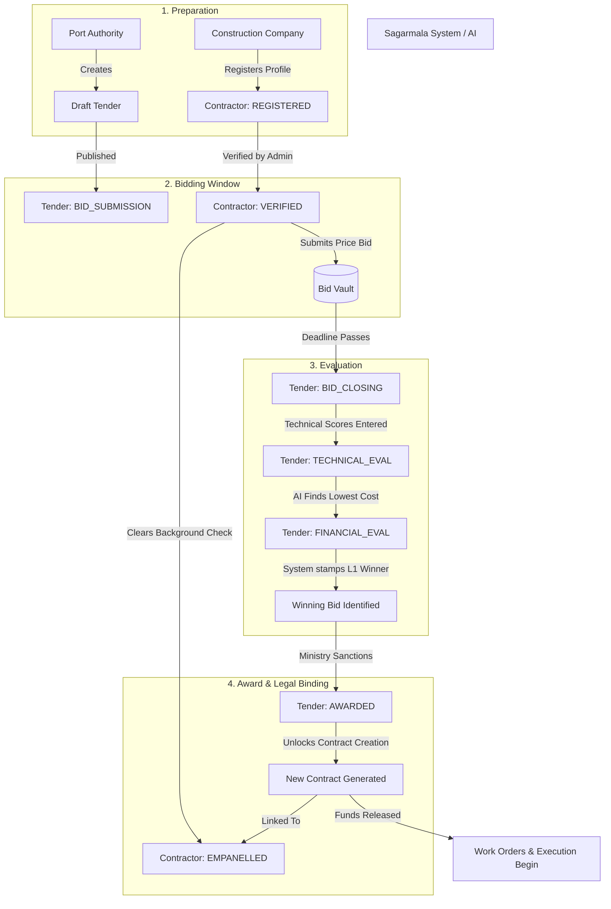

# Sagarmala 2.0 — Phase 2 Procurement Workflow

This document explains the exact relationship and data flow between **Tenders**, **Contractors**, and **Contracts**. Because these three modules interact heavily, they must be executed in a specific sequence.

## Core Truths
1. **Tenders** are the project requirement (The Job).
2. **Contractors** are the companies bidding on the job.
3. **Contracts** are the binding legal agreements created ONLY when a Contractor wins a Tender.

---

## The Procurement Lifecycle (Mermaid Diagram)

## How the Database Links Them Together

When fixing bugs or querying data across these three pages, this is how they connect in the database:

1. **A Tender is created.** (`id = 1`)
2. **Multiple Contractors register.** (`company_id = 10`, `company_id = 11`)
3. Contractors submit **Bids** linking themselves to the Tender. (`tender_id = 1`, `contractor_id = 10`)
4. The Tender **Awards** the lowest Bid. (`awarded_bid_id = 55`)
5. The **Contract** is generated. It ONLY references the `tender_id = 1`. 
   > *Note:* The Contract does not store the Contractor's ID directly. To find out who the contract belongs to, the system checks: Contract → Tender → Awarded Bid → Contractor.

## Why You Kept Getting Stuck Testing:
The rule is **D14**: *Contracts enforce the D14 rule: cannot be created against un-awarded tenders.*
Because you bypassed the AI Evaluation stage, the Tender reached `AWARDED` without an `awarded_bid_id`. When you opened the **Contracts** page, the system blocked you from creating a contract because it mathematically couldn't find a winning Contractor!
